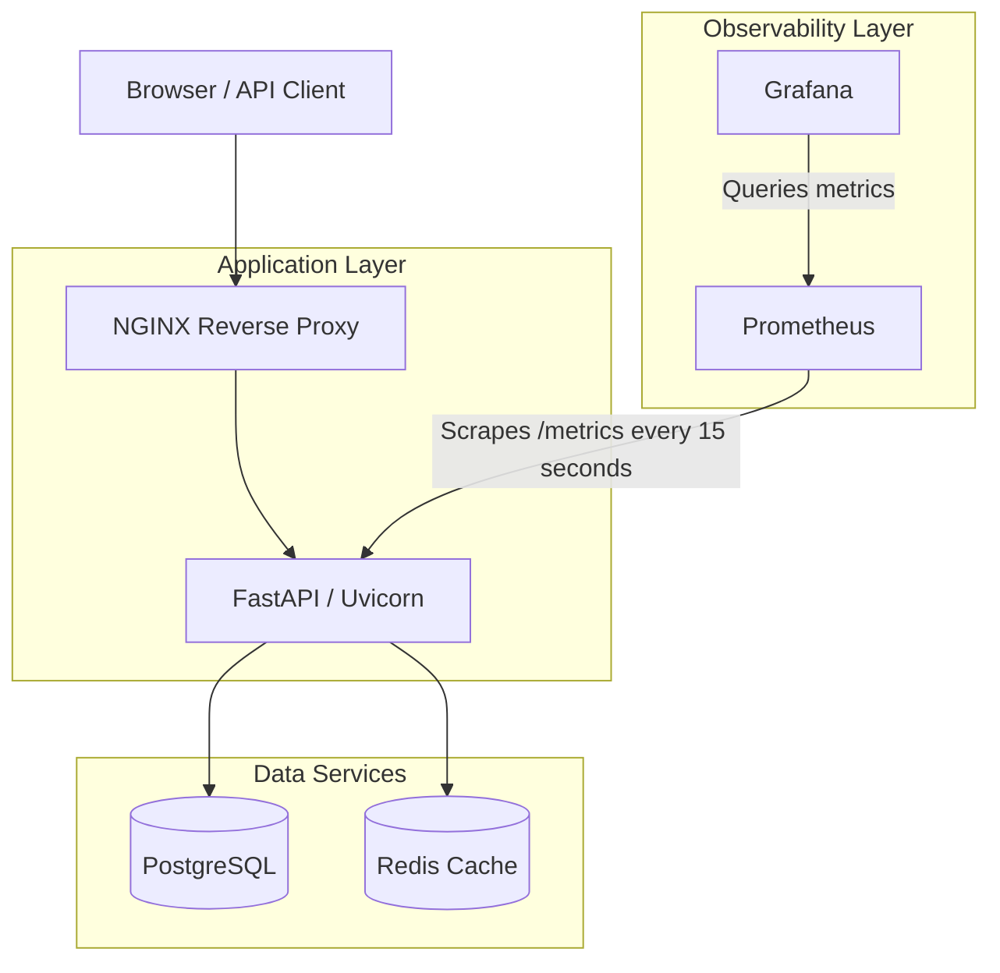

<div align="center">

# DOCKERFORGE

**Multi-Container Application Orchestration Platform**

A local Docker Compose project demonstrating container orchestration, backend services, persistent storage, caching, observability, and container security.


[](LICENSE)

[Architecture](#architecture) · [Features](#key-features) · [Quick Start](#quick-start) · [Testing](#testing) · [Security](#security-and-operational-considerations) · [Documentation](#documentation)

</div>

---

DOCKERFORGE is a single-host, six-service engineering project built around a FastAPI application. It integrates PostgreSQL for relational persistence, Redis for caching, NGINX as a reverse proxy, Prometheus for metrics collection, and Grafana for visualization. It focuses on practical DevOps workflows: health checks, operational recovery, integration testing, and security-conscious container configuration.

## Table of Contents

- [Overview](#overview)
- [Architecture](#architecture)
- [Services and Ports](#services-and-ports)
- [Key Features](#key-features)
- [Application Endpoints](#application-endpoints)
- [Observability](#observability)
- [Persistent Storage](#persistent-storage)
- [Quick Start](#quick-start)
- [Development Workflow](#development-workflow)
- [Testing](#testing)
- [Project Structure](#project-structure)
- [Documentation](#documentation)
- [Security and Operational Considerations](#security-and-operational-considerations)
- [Current Scope and Future Improvements](#current-scope-and-future-improvements)
- [License](#license)

## Overview

| | |
|---|---|
| **Deployment** | Docker Compose on a single host |
| **Backend** | Python, FastAPI, Uvicorn |
| **Database / cache** | PostgreSQL 16 / Redis 7 |
| **Reverse proxy** | NGINX |
| **Monitoring** | Prometheus and Grafana |
| **Testing** | Pytest unit tests and opt-in live integration tests |
| **Container security** | Non-root API, read-only filesystems and dropped capabilities where configured, `no-new-privileges` |

## Architecture



The production stack consists of six services: `api`, `postgres`, `redis`, `nginx`, `prometheus`, and `grafana`.

## Services and Ports

| Service | Technology | Access |
|---|---|---|
| API | FastAPI / Uvicorn | Internal port `8000` |
| PostgreSQL | PostgreSQL 16 | Internal port `5432` |
| Redis | Redis 7 | Internal port `6379` |
| NGINX | NGINX Alpine | `http://localhost:8088` |
| Prometheus | Prometheus v3.5.0 | `http://localhost:9092` |
| Grafana | Grafana 12.1.0 | `http://localhost:3002` |

NGINX is published on host port `8088` and bound to all host interfaces. Prometheus and Grafana are bound to loopback. The API, PostgreSQL, and Redis ports are not published directly to the host in the production Compose configuration.

## Key Features

**Container orchestration with Docker Compose**
- Six services defined in `compose.yaml`, with a separate `compose.dev.yaml` development override.

**API and reverse proxy**
- FastAPI application served by Uvicorn.
- NGINX is the HTTP entry point and forwards requests to the internal API service.

**PostgreSQL persistence and Redis cache fallback**
- PostgreSQL for relational persistence; Redis for cache storage and retrieval.
- Repeated requests can return cached data; when Redis is unavailable, the application bypasses the cache and falls back to PostgreSQL.

**Monitoring**
- Prometheus scrapes API metrics every 15 seconds.
- Grafana provides the visualization layer.
- Request counters and duration histograms support traffic and latency analysis.

**Reliability and operations**
- Health checks for all six services and service restart policies.
- Bounded container logging with rotation.
- Documented recovery procedures for API, database, cache, and reverse-proxy issues.

**Container security**
- The API runs as a non-root user with a read-only root filesystem and dropped Linux capabilities.
- Prometheus and Grafana have configured container restrictions; their interfaces are bound to loopback.
- Runtime credentials are supplied through environment configuration.
- Controls differ between services; see the [architecture document](docs/architecture.md).

**Testing**
- Pytest unit tests and opt-in live integration tests.

## Application Endpoints

| Endpoint | Purpose |
|---|---|
| `/` | Application information |
| `/health` | Application health check |
| `/db-health` | Database connectivity check |
| `/cache-demo` | Cache behavior and fallback demonstration |
| `/metrics` | Prometheus metrics endpoint; excluded from the generated OpenAPI schema |

The application is normally accessed through NGINX at `http://localhost:8088`, for example `http://localhost:8088/health`. Prometheus is at `http://localhost:9092` and Grafana at `http://localhost:3002`.

## Observability

Prometheus collects API metrics using this configuration:

- **Job:** `dockerforge-api`
- **Target:** `api:8000`
- **Metrics path:** `/metrics`
- **Scrape interval:** 15 seconds

| Metric | Purpose |
|---|---|
| `dockerforge_http_requests_total` | Counts HTTP requests |
| `dockerforge_http_request_duration_seconds` | Measures HTTP request duration |

Grafana uses Prometheus as its metrics source where configured.

## Persistent Storage

| Volume | Mount path | Purpose |
|---|---|---|
| `postgres-data` | `/var/lib/postgresql/data` | PostgreSQL data |
| `prometheus-data` | `/prometheus` | Prometheus time-series data |
| `grafana-data` | `/var/lib/grafana` | Grafana application data |

Docker Compose prefixes volume names with the project name. Redis currently uses an anonymous volume for `/data`.

> **Data safety:** Do not use `docker compose down -v` or delete volumes as a routine restart or troubleshooting step. Back up important data before destructive maintenance and verify that backups can be restored.

## Quick Start

**Prerequisites:** Docker Desktop with Docker Compose, Python 3.12 (for local tests), Git, and Windows PowerShell or a compatible shell.

**1. Clone the repository** (replace the placeholder with your repository URL)

```powershell
git clone <YOUR_GITHUB_REPOSITORY_URL>
cd DOCKERFORGE
```

**2. Configure environment variables**

```powershell
Copy-Item .env.example .env
```

Fill in the database credentials, database and cache connection URLs, log level, and the Grafana administrator password required by the Compose configuration. **Never commit `.env` or expose its contents.**

**3. Validate the Compose configuration**

```powershell
docker compose -f compose.yaml config --quiet

if ($LASTEXITCODE -ne 0) {
    throw "Production Compose validation failed."
}
```

**4. Start the stack**

```powershell
docker compose up -d
```

**5. Check health**

```powershell
docker compose ps

Invoke-RestMethod -Uri "http://localhost:8088/health" -TimeoutSec 15
Invoke-RestMethod -Uri "http://localhost:8088/db-health" -TimeoutSec 15
Invoke-RestMethod -Uri "http://localhost:8088/cache-demo" -TimeoutSec 15
```

**6. Inspect logs**

```powershell
docker compose logs --tail 100 api
docker compose logs --tail 100 postgres
docker compose logs --tail 100 redis
```

## Development Workflow

`compose.dev.yaml` mounts the application source read-only and enables Uvicorn reload.

```powershell
docker compose -f compose.yaml -f compose.dev.yaml config --quiet
docker compose -f compose.yaml -f compose.dev.yaml up -d
```

## Testing

**Unit tests** — activate the project's Python virtual environment, then run:

```powershell
python -m pytest -q
```

Live integration tests are skipped by default unless the integration environment variable is enabled.

**Live integration tests** — these require a running, healthy stack:

```powershell
$ErrorActionPreference = "Stop"
$env:DOCKERFORGE_INTEGRATION = "1"

try {
    python -m pytest -q tests/integration/test_stack.py

    if ($LASTEXITCODE -ne 0) {
        throw "Live integration tests failed."
    }
}
finally {
    Remove-Item Env:\DOCKERFORGE_INTEGRATION -ErrorAction SilentlyContinue
}
```

## Project Structure

```text
DOCKERFORGE/
├── app/
│   ├── main.py
│   ├── database.py
│   └── redis.py
├── docs/
│   ├── architecture.md
│   └── operations-runbook.md
├── grafana/
├── nginx/
│   └── nginx.conf
├── prometheus/
│   └── prometheus.yml
├── tests/
│   └── integration/
├── .github/
│   └── workflows/
│       └── ci.yml
├── .dockerignore
├── .env.example
├── .gitignore
├── compose.yaml
├── compose.dev.yaml
├── Dockerfile
├── LICENSE
└── requirements.txt
```

This is a high-level file map; individual configuration and test files may vary as the project evolves.

## Documentation

- [System Architecture](docs/architecture.md): service relationships, request flow, ports, volumes, security controls, and limitations.
- [Operations Runbook](docs/operations-runbook.md): startup, health checks, monitoring, troubleshooting, recovery, testing, and data-protection procedures.

## Security and Operational Considerations

- Keep `.env` and credential-bearing backups out of version control.
- Review host-interface exposure and firewall settings before allowing external access.
- Do not assume all services use identical container hardening.
- Health checks and restart policies do not guarantee high availability.
- Validate backups and restoration procedures before relying on them.
- Assess TLS and application access controls before exposing the service beyond a trusted local environment.

## Current Scope and Future Improvements

DOCKERFORGE is a local Docker Compose project. It is not a Kubernetes cluster, a multi-node orchestrator, a cloud deployment, or a high-availability production system, and it is not production-certified.

**Future recommendations (not implemented):**

- TLS and stronger application access controls.
- Documented and tested backup restoration.
- Resource sizing and capacity testing.
- Further container hardening where compatible with each service.
- Expanded failure-recovery testing.
- Additional monitoring and alerting capabilities, once implemented and validated.

## License

This project is distributed under the MIT License. See [`LICENSE`](LICENSE) for the license text.
