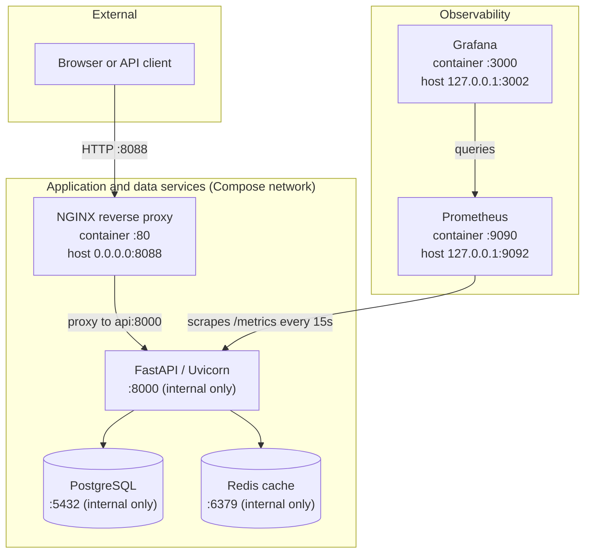
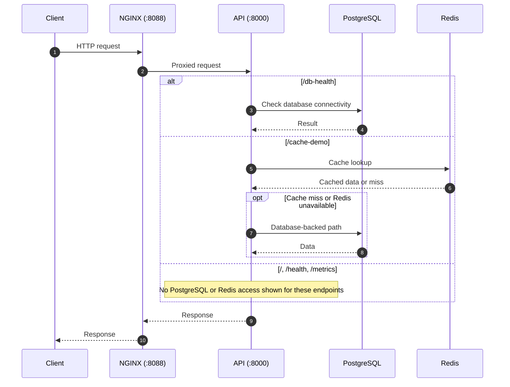
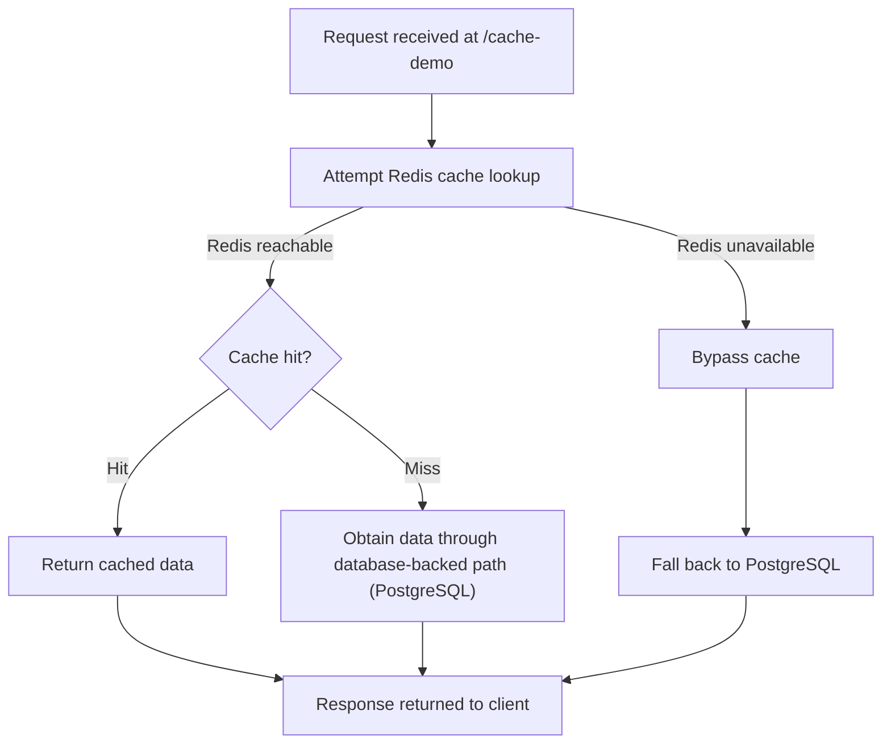
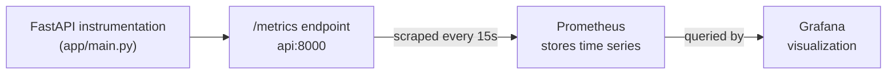

# DOCKERFORGE — System Architecture

> Local Docker Compose orchestration of a FastAPI application with PostgreSQL, Redis, NGINX, Prometheus, and Grafana, with a focus on containerization, observability, reliability, and container security.

| | |
|---|---|
| **Deployment model** | Local Docker Compose (six services, single host) |
| **Application** | Python 3.12 (`python:3.12-slim` base), FastAPI, Uvicorn |
| **Data services** | PostgreSQL 16, Redis 7 |
| **Edge** | NGINX (`nginx:alpine`) reverse proxy |
| **Observability** | Prometheus v3.5.0, Grafana 12.1.0 |
| **Compose files** | `compose.yaml` (production), `compose.dev.yaml` (development override) |
| **Status** | Documents the current implementation |

## Table of Contents

- [DOCKERFORGE — System Architecture](#dockerforge--system-architecture)
  - [Table of Contents](#table-of-contents)
  - [1. Overview](#1-overview)
  - [2. High-Level Architecture](#2-high-level-architecture)
  - [3. Service Reference](#3-service-reference)
  - [4. Request and Data Flow](#4-request-and-data-flow)
    - [Application requests](#application-requests)
    - [Database health](#database-health)
    - [Cache demonstration and fallback](#cache-demonstration-and-fallback)
  - [5. Application Endpoints](#5-application-endpoints)
  - [6. Network and Port Exposure](#6-network-and-port-exposure)
  - [7. Persistent Storage](#7-persistent-storage)
  - [8. Monitoring and Metrics](#8-monitoring-and-metrics)
  - [9. Container Health and Recovery](#9-container-health-and-recovery)
  - [10. Security Controls](#10-security-controls)
    - [Service matrix](#service-matrix)
    - [Details](#details)
    - [Secrets and remaining considerations](#secrets-and-remaining-considerations)
  - [11. Operations and Development Workflow](#11-operations-and-development-workflow)
  - [12. Project File Map](#12-project-file-map)
  - [13. Current Scope and Limitations](#13-current-scope-and-limitations)
  - [14. Future Recommendations](#14-future-recommendations)

---

## 1. Overview

DOCKERFORGE is a containerized application orchestration and operations project built with Docker Compose. It combines a Python FastAPI application, PostgreSQL persistence, Redis caching, an NGINX reverse proxy, Prometheus metrics collection, and Grafana monitoring.

The stack contains six services:

- **API:** FastAPI application served by Uvicorn.
- **PostgreSQL:** relational database for persistent application data.
- **Redis:** in-memory cache.
- **NGINX:** reverse proxy and public application entry point.
- **Prometheus:** metrics collection and querying.
- **Grafana:** monitoring dashboards and visualization.

Services communicate over the Docker Compose network. Database and cache ports are not published to the host.

## 2. High-Level Architecture



Prometheus scrapes the API's `/metrics` endpoint. Grafana uses Prometheus as its metrics source when configured accordingly.

## 3. Service Reference

| Service | Image / build | Responsibility | Internal port | Host exposure | Dependencies / data flow |
|---|---|---|---|---|---|
| API | Locally built `dockerforge:0.2.0` | HTTP endpoints, application logic, database and cache access, request metrics | `8000` | None | Uses PostgreSQL and Redis; scraped by Prometheus |
| PostgreSQL | `postgres:16` | Persistent relational storage | `5432` | None | Accessed by the API |
| Redis | `redis:7` | Cache storage and retrieval | `6379` | None | Accessed by the API |
| NGINX | `nginx:alpine` | Proxies HTTP requests to the API | `80` | `0.0.0.0:8088:80` | Forwards to `api:8000` |
| Prometheus | `prom/prometheus:v3.5.0` | Scrapes and stores time-series metrics | `9090` | `127.0.0.1:9092:9090` | Scrapes `api:8000/metrics` |
| Grafana | `grafana/grafana:12.1.0` | Monitoring visualization and dashboards | `3000` | `127.0.0.1:3002:3000` | Queries Prometheus |

Images and service definitions are managed in `compose.yaml`.

## 4. Request and Data Flow

### Application requests

1. A client sends an HTTP request to the host's NGINX port, `8088`.
2. NGINX forwards the request to `api:8000` on the Compose network.
3. FastAPI processes the request and returns a response.
4. Depending on the endpoint, the API can query PostgreSQL or use Redis.
5. NGINX returns the API response to the client.

NGINX forwards the `Host`, `X-Real-IP`, `X-Forwarded-For`, and `X-Forwarded-Proto` headers.



The backend dependency depends on the requested endpoint; not every request touches PostgreSQL or Redis.

### Database health

The `/db-health` endpoint checks database connectivity. PostgreSQL stores persistent application data in its named Docker volume.

### Cache demonstration and fallback

The `/cache-demo` endpoint demonstrates cache behavior using Redis and PostgreSQL. Repeated requests can return cached data. When Redis is unavailable, the application can bypass the cache and fall back to PostgreSQL rather than requiring the cache for every request.



Only `/cache-demo` demonstrates this behavior. The fallback does not make Redis persistent storage; PostgreSQL remains the relational database.

## 5. Application Endpoints

The following endpoints are implemented in the FastAPI application. HTTP methods, authentication requirements, response schemas, and status codes are not specified here; see `app/main.py` and `app/database.py`.

| Endpoint | Purpose | Backend dependency |
|---|---|---|
| `/` | Root or application information endpoint | Not documented |
| `/health` | Application health check | Not documented |
| `/db-health` | Database connectivity check | PostgreSQL |
| `/cache-demo` | Demonstrates cache behavior and fallback | Redis, with PostgreSQL as fallback |
| `/metrics` | Prometheus metrics endpoint; excluded from the generated OpenAPI schema | None |

## 6. Network and Port Exposure

| Host address / port | Service | Purpose |
|---|---|---|
| `0.0.0.0:8088` | NGINX | Application HTTP entry point |
| `127.0.0.1:9092` | Prometheus | Local metrics interface |
| `127.0.0.1:3002` | Grafana | Local monitoring interface |

The API listens on `8000`, PostgreSQL on `5432`, and Redis on `6379` inside the Compose network only; none publish host ports.

> **Security note:** NGINX is bound to all host interfaces (`0.0.0.0`), so it is reachable from other machines on the host's network unless a firewall blocks it. Prometheus and Grafana are bound to loopback (`127.0.0.1`), so they are reachable only from the host itself. Actual reachability also depends on host firewall, network, and Docker configuration.

## 7. Persistent Storage

| Volume | Container mount | Purpose |
|---|---|---|
| `postgres-data` | `/var/lib/postgresql/data` | PostgreSQL database files |
| `prometheus-data` | `/prometheus` | Prometheus time-series data |
| `grafana-data` | `/var/lib/grafana` | Grafana application data |

Docker Compose prefixes named volumes with the project name when creating their actual Docker names. For example, the PostgreSQL volume is `dockerforge_postgres-data`.

Redis has a data directory at `/data` backed by the image's **anonymous volume**. It is not equivalent to a deliberately named, independently managed volume and should not be assumed to share their lifecycle guarantees.

> **Data-protection warning:** Do not run `docker compose down -v` or delete volumes as a routine restart or troubleshooting step. Doing so can permanently destroy PostgreSQL data, Prometheus history, and Grafana data, and may also discard Redis's anonymous volume. Back up important data before any volume removal.

## 8. Monitoring and Metrics



Prometheus configuration is in `prometheus/prometheus.yml`:

| Setting | Value |
|---|---|
| Global scrape interval | 15 seconds |
| Global evaluation interval | 15 seconds |
| Job name | `dockerforge-api` |
| Target | `api:8000` |
| Metrics path | `/metrics` |

The FastAPI application records:

| Metric | Type | Measures |
|---|---|---|
| `dockerforge_http_requests_total` | Counter | Cumulative HTTP requests; a counter only increases, so it supports request-volume and rate analysis |
| `dockerforge_http_request_duration_seconds` | Histogram | Distribution of request durations in buckets, supporting latency analysis |

Prometheus collects and stores these metrics and exposes a local web interface. Grafana is the visualization layer and queries Prometheus as its data source. This document does not claim any specific dashboards or alerting rules beyond what is configured under `grafana/` and `prometheus/`.

## 9. Container Health and Recovery

The Compose configuration defines health checks for all six services. Dependencies use health conditions where configured, so dependent services can wait for required services to become healthy. All services use the `unless-stopped` restart policy.

| Mechanism | What it provides | What it does not guarantee |
|---|---|---|
| Health checks | Reports whether a container's check is passing | Application correctness beyond the check itself |
| Health-based `depends_on` (where configured) | Delays dependent services until required services are healthy | Continued availability of a dependency after startup |
| `unless-stopped` restart policy | Restarts containers after certain process exits | Root-cause resolution, data recovery, high availability, or incident response |

Restart policies do not replace monitoring, backups, or incident response.

Operational verification:

- `docker compose ps` for container status.
- `docker compose logs --tail 100 <service>` for recent logs.
- `docker compose exec -T postgres pg_isready` for PostgreSQL readiness.
- `docker compose exec -T redis redis-cli ping` for Redis connectivity.
- Application endpoint checks through `http://localhost:8088`.
- Prometheus target status and Grafana health checks.

## 10. Security Controls

### Service matrix

| Control | API | Prometheus | Grafana | NGINX | PostgreSQL | Redis |
|---|:---:|:---:|:---:|:---:|:---:|:---:|
| Non-root user | `appuser` | — | — | — | — | — |
| Read-only root filesystem | Yes | Yes | Yes | No | No | No |
| All Linux capabilities dropped | Yes | Yes | Yes | No | No | No |
| `no-new-privileges` | Yes | Yes | Yes | Yes | — | — |
| Restricted `/tmp` tmpfs | Yes | Yes | Yes | — | — | — |
| Host interface | None | Loopback | Loopback | `0.0.0.0` | None | None |

"—" means the control is not documented as configured; it should not be assumed present. "No" for NGINX, PostgreSQL, and Redis means the same hardening as the API, Prometheus, and Grafana has not been applied.

### Details

- **API:** built from `python:3.12-slim`; runs as non-root `appuser`; read-only root filesystem; all capabilities dropped; `no-new-privileges`; restricted `/tmp` tmpfs.
- **Prometheus and Grafana:** all capabilities dropped; `no-new-privileges`; read-only root filesystems; restricted `/tmp` tmpfs; host interfaces bound to loopback.
- **NGINX:** `no-new-privileges`; proxies to the internal API; the API port is not published to the host.
- **PostgreSQL and Redis:** retain their working entrypoint and capability configurations. Do not assume all services have identical hardening.

### Secrets and remaining considerations

- Runtime configuration is supplied through environment variables.
- `.env.example` documents required variable names and must contain placeholders, not real credentials.
- The Grafana administrator password is required by the Compose configuration.
- Never commit `.env` or credential backups.
- `no-new-privileges` and container-level restrictions do not replace patching, network controls, secret management, backups, or host security.

This project is not claimed to be completely secure or production-certified.

## 11. Operations and Development Workflow

The production stack is defined in `compose.yaml`. The development override, `compose.dev.yaml`, mounts the application source read-only and overrides the API command to enable Uvicorn reload.

**Validate both configurations before applying changes:**

```powershell
docker compose -f compose.yaml config --quiet
docker compose -f compose.yaml -f compose.dev.yaml config --quiet
```

**Start or reconcile the production stack:**

```powershell
docker compose up -d
```

**Inspect status and logs:**

```powershell
docker compose ps
docker compose logs --tail 100 <service>
```

**Check PostgreSQL readiness and Redis connectivity:**

```powershell
docker compose exec -T postgres pg_isready
docker compose exec -T redis redis-cli ping
```

**Run unit tests** from the project's Python virtual environment:

```powershell
python -m pytest -q
```

**Run the live integration suite** against a running stack:

```powershell
$env:DOCKERFORGE_INTEGRATION = "1"
python -m pytest -q tests/integration/test_stack.py
Remove-Item Env:\DOCKERFORGE_INTEGRATION -ErrorAction SilentlyContinue
```

## 12. Project File Map

| Path | Purpose |
|---|---|
| `compose.yaml` | Production service definitions, networking, volumes, health checks, and security settings |
| `compose.dev.yaml` | Development override |
| `Dockerfile` | API image build and runtime user |
| `requirements.txt` | Python dependencies |
| `app/main.py` | FastAPI application, endpoints, and request metrics |
| `app/database.py` | Database-related operations |
| `app/redis.py` | Redis client and cache operations |
| `nginx/nginx.conf` | Reverse-proxy configuration |
| `prometheus/prometheus.yml` | Metrics scrape configuration |
| `grafana/` | Grafana provisioning and dashboard assets, where configured |
| `tests/` | Unit and integration tests |
| `.env.example` | Environment variable template |

## 13. Current Scope and Limitations

This document describes the repository's current six-service Docker Compose architecture. DOCKERFORGE is a local Docker Compose project. It is not a Kubernetes cluster, a production-managed orchestration cluster, a high-availability deployment, or a fully automated remediation platform.

The stack has been tested locally, including application health, database access, Redis cache behavior, Prometheus scraping, and live integration scenarios. Production deployment would require additional review of TLS, access control, secret management, backup restoration, resource sizing, and host/network exposure.

## 14. Future Recommendations

The following are recommendations, **not implemented features**:

- TLS termination and stronger access control.
- Backup and restore validation for PostgreSQL and other stateful data.
- Resource sizing and capacity testing.
- Improved secret management.
- Additional failure-recovery tests.
- Further container hardening where compatible with the service images (for example, NGINX, PostgreSQL, and Redis).

---

**Document status:** Architecture documentation for the current DOCKERFORGE implementation.
