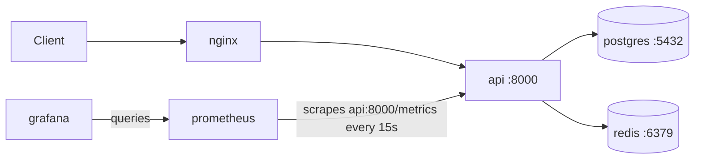
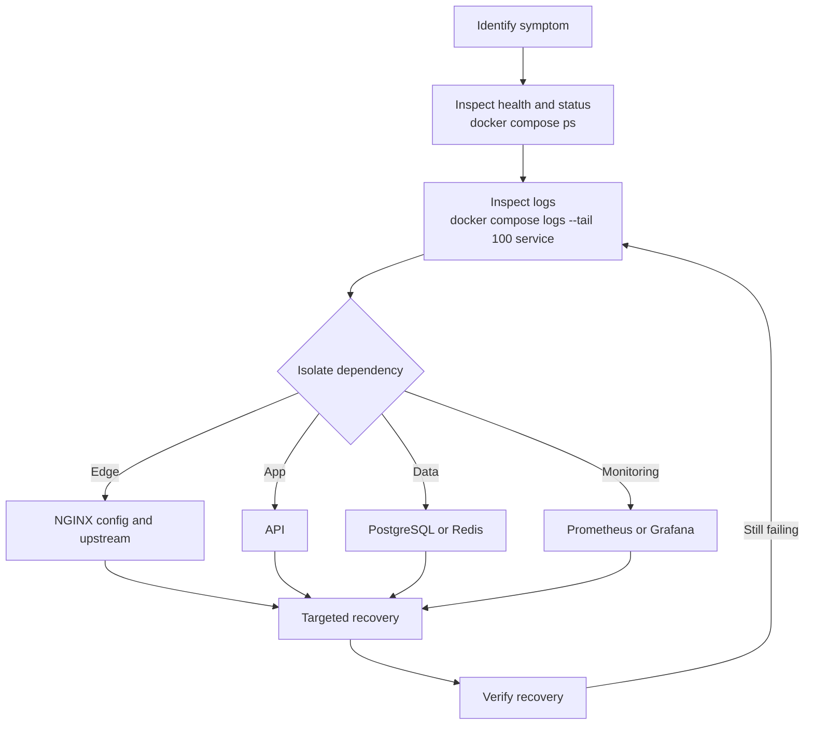

# DOCKERFORGE — Operations Runbook

> Safe operational procedures for the DOCKERFORGE Docker Compose stack: startup, health checks, logs, monitoring, testing, troubleshooting, and recovery. Commands are Windows PowerShell and run from the project root, where `compose.yaml` is located.

The production stack has six services: `api`, `postgres`, `redis`, `nginx`, `prometheus`, `grafana`.

## Table of Contents

- [DOCKERFORGE — Operations Runbook](#dockerforge--operations-runbook)
  - [Table of Contents](#table-of-contents)
  - [1. Safety Rules](#1-safety-rules)
  - [2. Service Map and Ports](#2-service-map-and-ports)
  - [3. Quick Command Reference](#3-quick-command-reference)
  - [4. Health Check Matrix](#4-health-check-matrix)
  - [5. Troubleshooting](#5-troubleshooting)
  - [6. Recovery Procedures](#6-recovery-procedures)
    - [Restart a single service](#restart-a-single-service)
    - [Recreate one service without its dependencies](#recreate-one-service-without-its-dependencies)
    - [PostgreSQL recovery](#postgresql-recovery)
    - [Redis recovery](#redis-recovery)
    - [NGINX recovery](#nginx-recovery)
  - [7. Monitoring and Verification](#7-monitoring-and-verification)
  - [8. Tests and Change Management](#8-tests-and-change-management)
    - [Unit tests](#unit-tests)
    - [Live integration tests](#live-integration-tests)
    - [Git and Compose checks](#git-and-compose-checks)
    - [Change procedure](#change-procedure)
  - [9. Data Protection and Secrets](#9-data-protection-and-secrets)
    - [Persistent data](#persistent-data)
    - [Environment variables](#environment-variables)
  - [10. Operational Checklists](#10-operational-checklists)
  - [11. Known Limitations](#11-known-limitations)

---

## 1. Safety Rules

> **⚠️ CRITICAL — destructive operations**
> - **Never** use `docker compose down -v` to restart the application.
> - **Never** delete Docker volumes as a routine troubleshooting step.
> - **Avoid** global cleanup commands (`docker system prune`, `docker volume prune`) for routine maintenance.

- Never print or commit `.env` contents.
- Do not recreate unrelated project containers.
- Before changing configuration, inspect the current Git diff and validate Compose.
- Use `docker compose logs --tail 100 <service>` to limit log output.
- Protect database backups and credentials as sensitive data.

Three operations are different. Know which one you are performing:

| Operation | Example | Effect on data volumes |
|---|---|---|
| **Process restart** | `docker compose restart api` | None; same container |
| **Container recreation** | `docker compose up -d --no-deps --force-recreate api` | Named volumes are retained; container filesystem is replaced |
| **Data-volume deletion** | `docker compose down -v`, `docker volume rm` | **Destroys stored data** — not a troubleshooting step |

## 2. Service Map and Ports



| Service | Host access | Binding | Purpose |
|---|---|---|---|
| NGINX | `http://localhost:8088` | All host interfaces | Application entry point |
| Prometheus | `http://localhost:9092` | Loopback only | Metrics and target status |
| Grafana | `http://localhost:3002` | Loopback only | Monitoring interface |
| API | Internal port `8000` | Not published | Application endpoints |
| PostgreSQL | Internal port `5432` | Not published | Relational database |
| Redis | Internal port `6379` | Not published | Cache |

API, PostgreSQL, and Redis ports are not published directly to the host in the current production configuration.

## 3. Quick Command Reference

**Validate Compose files**

```powershell
docker compose -f compose.yaml config --quiet
if ($LASTEXITCODE -ne 0) { throw "Production Compose validation failed." }

docker compose -f compose.yaml -f compose.dev.yaml config --quiet
if ($LASTEXITCODE -ne 0) { throw "Development Compose validation failed." }
```

**Start or reconcile the production stack** (Compose may recreate containers whose configuration or image changed)

```powershell
docker compose up -d
if ($LASTEXITCODE -ne 0) { throw "Compose startup failed." }
```

**Service status**

```powershell
docker compose ps
docker compose ps api   # or postgres, redis, nginx, prometheus, grafana
```

All six services should be running and report `healthy`.

**Application endpoints (through NGINX)**

```powershell
$ErrorActionPreference = "Stop"

foreach ($path in @("/health", "/db-health", "/cache-demo")) {
    $uri = "http://localhost:8088$path"
    $result = Invoke-RestMethod -Uri $uri -TimeoutSec 15
    Write-Host "$path : PASS"
}
```

- `/health`: application health.
- `/db-health`: database connectivity.
- `/cache-demo`: cache demonstration and fallback behavior.

**Bounded logs**

```powershell
docker compose logs --tail 100 api
docker compose logs --tail 50 --follow api   # Ctrl+C to stop
docker compose logs --tail 50                # all services
```

**PostgreSQL and Redis**

```powershell
docker compose exec -T postgres pg_isready
docker compose exec -T redis redis-cli ping   # expect PONG
```

**Prometheus and Grafana**

```powershell
Invoke-RestMethod -Uri "http://localhost:9092/-/healthy" -TimeoutSec 10
Invoke-RestMethod -Uri "http://localhost:3002/api/health" -TimeoutSec 10 | Select-Object database, version, commit
```

**Docker health-check details** (replace `dockerforge-api` with the relevant container name)

```powershell
docker inspect dockerforge-api --format '{{json .State.Health}}'
```

**Tests** — see [Section 8](#8-tests-and-change-management).

Do not share unredacted logs publicly without checking for credentials, tokens, or personal data.

## 4. Health Check Matrix

| Service | Check | Expected result | Next diagnostic step |
|---|---|---|---|
| NGINX | `docker compose exec -T nginx nginx -t`; `http://localhost:8088/health` | Configuration test passes; request succeeds | `docker compose logs --tail 100 nginx`, then check API |
| API | `http://localhost:8088/health` | Request succeeds | `docker compose logs --tail 100 api` |
| PostgreSQL | `docker compose exec -T postgres pg_isready`; `/db-health` | Accepting connections; request succeeds | `docker compose logs --tail 100 postgres`; confirm volume attached |
| Redis | `docker compose exec -T redis redis-cli ping`; `/cache-demo` | `PONG`; request succeeds | `docker compose logs --tail 100 redis` |
| Prometheus | `http://localhost:9092/-/healthy` | Request succeeds | `docker compose logs --tail 100 prometheus` |
| Grafana | `http://localhost:3002/api/health` | `database` field reports `ok` | `docker compose logs --tail 100 grafana` |

A healthy endpoint does not prove every dependency is healthy. For example, a successful `/cache-demo` can result from the PostgreSQL fallback while Redis is down.

## 5. Troubleshooting



For every symptom: check `docker compose ps`, read bounded logs, and change one thing at a time.

| Symptom | Diagnose | Safe corrective action | Verify |
|---|---|---|---|
| **API unavailable** | `docker compose ps api`; `docker compose logs --tail 100 api`; check `postgres` and `redis` status | Fix the cause found in logs; `docker compose restart api` | `/health` and `/db-health` via `http://localhost:8088` |
| **PostgreSQL unhealthy** | `pg_isready`; `docker compose logs --tail 100 postgres`; confirm named volume attached | See [PostgreSQL recovery](#postgresql-recovery); never delete the data volume | `pg_isready`; `/db-health` |
| **Redis unavailable / fallback active** | `redis-cli ping`; Redis logs; `/cache-demo` | See [Redis recovery](#redis-recovery) | `PONG`; repeated `/cache-demo` shows cache hit |
| **NGINX proxy failures** | `nginx -t`; NGINX logs; API status | Fix config; if NGINX is healthy but requests fail, inspect API | `/health` through `:8088` |
| **Prometheus target down** | Query `up{job="dockerforge-api"}`; API status and `/metrics` reachability; Prometheus logs | Restore the API; restart Prometheus only if needed | `up` value `1` |
| **Grafana health failure** | `/api/health`; Grafana logs | `docker compose restart grafana` if no config change is needed | `database` reports `ok` |
| **Repeated restarts** | `docker compose ps`; logs; `docker inspect <container> --format '{{json .State.Health}}'` | Identify the failing service and cause from logs; validate Compose; recreate only that service if justified | Service stays `healthy` |

## 6. Recovery Procedures

### Restart a single service

For a process restart when configuration does not need to change. A restart may not resolve configuration or image problems.

```powershell
docker compose restart api
docker compose ps api
Invoke-RestMethod -Uri "http://localhost:8088/health" -TimeoutSec 15
```

Replace `api` with the intended Compose service name.

### Recreate one service without its dependencies

Only when recreation is required, for example after a verified configuration or image update. It can interrupt requests; verify health afterward.

```powershell
docker compose up -d --no-deps --force-recreate api
```

### PostgreSQL recovery

1. `docker compose ps postgres`
2. `docker compose exec -T postgres pg_isready`
3. `docker compose logs --tail 100 postgres`
4. Confirm the expected named volume is attached.
5. Determine the cause before considering recreation or restoration.

Recreating the PostgreSQL container is not the same as deleting its data volume. **Never delete the database volume to fix an unexplained startup issue.**

### Redis recovery

1. `docker compose ps redis`
2. `docker compose exec -T redis redis-cli ping`
3. Inspect Redis logs.
4. Verify `/cache-demo` and whether the application is using its fallback path.
5. Restore Redis using the existing Compose configuration after identifying the cause.

> **⚠️ Redis hardening caveat:** An earlier attempt to drop all Linux capabilities prevented the official Redis entrypoint from switching to the Redis service user. The working configuration was restored. Do not repeat or apply untested capability restrictions to the Redis container.

The application has been tested to bypass the cache and fall back to PostgreSQL when Redis is unavailable. A successful fallback is not proof that Redis is healthy.

### NGINX recovery

```powershell
docker compose exec -T nginx nginx -t
docker compose logs --tail 100 nginx
Invoke-RestMethod -Uri "http://localhost:8088/health" -TimeoutSec 15
```

## 7. Monitoring and Verification

Prometheus job `dockerforge-api` scrapes target `api:8000` every 15 seconds. This runbook does not document alerting capabilities.

**Verify the API scrape target** (healthy value is `1`)

```powershell
$target = Invoke-RestMethod -Uri 'http://localhost:9092/api/v1/query?query=up%7Bjob%3D%22dockerforge-api%22%7D' -TimeoutSec 10

$target.data.result |
    ForEach-Object {
        [PSCustomObject]@{
            Job   = $_.metric.job
            Value = $_.value[1]
        }
    }
```

**Verify cache behavior**

```powershell
$first = Invoke-RestMethod -Uri "http://localhost:8088/cache-demo" -TimeoutSec 15
$second = Invoke-RestMethod -Uri "http://localhost:8088/cache-demo" -TimeoutSec 15

Write-Host "First request cached: $($first.cached)"
Write-Host "Second request cached: $($second.cached)"
```

The first result depends on existing cache state. A repeated request should show a cache hit when the key remains cached and Redis is operating normally.

**Monitoring logs**

```powershell
docker compose logs --tail 100 prometheus
docker compose logs --tail 100 grafana
```

## 8. Tests and Change Management

### Unit tests

Activate the project's virtual environment, then run:

```powershell
python -m pytest -q
```

Live integration tests are skipped by default unless the integration environment variable is enabled.

### Live integration tests

These **require a running local stack**.

```powershell
$ErrorActionPreference = "Stop"
$env:DOCKERFORGE_INTEGRATION = "1"

try {
    python -m pytest -q tests/integration/test_stack.py

    if ($LASTEXITCODE -ne 0) {
        throw "Live integration tests failed."
    }
}
finally {
    Remove-Item Env:\DOCKERFORGE_INTEGRATION -ErrorAction SilentlyContinue
}
```

### Git and Compose checks

```powershell
git diff --check
if ($LASTEXITCODE -ne 0) { throw "Git diff check failed." }

docker compose -f compose.yaml config --quiet
if ($LASTEXITCODE -ne 0) { throw "Production Compose validation failed." }

docker compose -f compose.yaml -f compose.dev.yaml config --quiet
if ($LASTEXITCODE -ne 0) { throw "Development Compose validation failed." }
```

Review `git status --short` and `git diff` before staging or committing.

### Change procedure

1. Inspect the current configuration and Git status.
2. Make one focused change.
3. Validate production and development Compose configurations.
4. Review `git diff --check` and `git diff`.
5. Apply only the required service changes.
6. Verify service health, endpoints, database and cache behavior, and monitoring.
7. Run unit and live integration tests where applicable.
8. Stage only the intended files.
9. Review the staged diff before committing.

Do not include unrelated backups or generated files in a commit.

## 9. Data Protection and Secrets

### Persistent data

PostgreSQL, Prometheus, and Grafana use named volumes; preserve them. Redis uses an anonymous volume for `/data` in the current configuration and should not be assumed to have the same lifecycle guarantees.

- Do not assume a container image or Git repository holds a recoverable copy of persistent data.
- Before a planned database migration or destructive maintenance, prepare and verify an appropriate backup.
- A backup is useful only if it can be restored; test restoration in a separate environment when feasible.
- Keep backups containing data or secrets out of public repositories, and do not delete or overwrite existing backups without confirming their purpose.

A backup strategy should be designed around the required recovery point and recovery time. This runbook does not claim that automated backups or restore drills are configured.

### Environment variables

`.env.example` documents these variable names:

`DATABASE_URL`, `GRAFANA_ADMIN_PASSWORD`, `LOG_LEVEL`, `POSTGRES_DB`, `POSTGRES_PASSWORD`, `POSTGRES_USER`, `REDIS_URL`

The actual `.env` must remain private and untracked. Never:

- Print `.env` contents into shared logs or chat.
- Commit `.env` or credential-bearing backups.
- Replace real credentials with sample values in a working `.env` without understanding the impact.
- Put real passwords in shell commands that will be saved in command history.

Before a commit:

```powershell
git status --short
git check-ignore .env
git ls-files --error-unmatch .env
```

The last command should fail if `.env` is not tracked. If it reports the file is tracked, stop and address that carefully; do not print its contents.

## 10. Operational Checklists

**Pre-change**

- [ ] `git status --short` and `git diff` reviewed
- [ ] Production and development Compose validated
- [ ] `docker compose ps` shows all six services `healthy`
- [ ] `/health`, `/db-health`, `/cache-demo` pass
- [ ] Prometheus `up{job="dockerforge-api"}` is `1`
- [ ] Persistent data protected; backup verified before destructive maintenance
- [ ] `.env` untracked and not printed

**Incident response**

- [ ] Symptom identified and recorded
- [ ] Status and health inspected
- [ ] Bounded logs read for the affected service
- [ ] Failing dependency isolated
- [ ] Targeted recovery only (no volume deletion, no global cleanup)
- [ ] Recovery verified

**Post-recovery**

- [ ] All six services `healthy`
- [ ] Application endpoints pass through `http://localhost:8088`
- [ ] `pg_isready` reports accepting connections; `redis-cli ping` returns `PONG`
- [ ] Cache behavior verified
- [ ] Prometheus target status is `1`; Grafana `database` reports `ok`
- [ ] Unit and (if relevant) live integration tests pass
- [ ] `git diff --check` and diff review clean
- [ ] PostgreSQL, Prometheus, and Grafana volumes intact

## 11. Known Limitations

- This is a local Docker Compose stack, not a multi-node orchestrator.
- Health checks and restart policies do not guarantee high availability.
- PostgreSQL and Redis have not been hardened with the same restrictions as the API, Prometheus, and Grafana.
- Automated backup scheduling and restore drills are not established by this document.
- TLS and application authentication requirements must be assessed before exposing the application beyond a trusted local environment.

---

**Document status:** Operational guidance for the current DOCKERFORGE Compose implementation.
